# 🎙️ Pitch Demo Orchestrator: Chiến Lược Trình Diễn & Thuyết Phục Ban Giám Khảo

## 🎯 Mục tiêu (Objective)
Tối ưu hóa và làm chủ toàn bộ bài thuyết trình sản phẩm kỹ thuật trước Hội đồng Giám khảo trong khoảng thời gian vàng **3 đến 5 phút**. Chuyển hóa các đột phá kỹ thuật (AI RAG, Cyber Security, Low-resource NLP) thành câu chuyện sản phẩm sắc bén, có tính thương mại hóa cao và không mắc bất kỳ lỗi demo nào trên sân khấu.

---

## 🔒 Ràng buộc kỹ thuật (Constraints)
1. **Quy tắc 180 Giây (Strict Time-Boxing)**: Phải hoàn thành toàn bộ phần trình diễn trong 3 phút đầu; dành 2 phút cuối cho phần hỏi đáp phản biện chuyên sâu. Tuyệt đối không để chuông hết giờ reo khi chưa mở được màn hình demo.
2. **Kịch bản Golden Path duy nhất**: Chỉ click đúng 3 thao tác chủ đạo đã diễn tập trước, không bấm lan man vào các tính năng phụ chưa hoàn thiện.
3. **Kế hoạch Dự phòng Bất khả xâm phạm (Murphy's Law Protocol)**: Luôn chuẩn bị sẵn video quay màn hình 1080p 60fps và chế độ `Mock Data Toggle` trên UI nếu mạng hội trường bị sập.
4. **Sơ đồ Kiến trúc Chuẩn Hóa**: Phải có 1 slide sơ đồ khối luồng dữ liệu (Dataflow) dạng Mermaid rõ ràng, làm nổi bật điểm khác biệt kỹ thuật so với các đội khác.

---

## 📋 Quy trình thực thi từng bước (Step-by-Step)

```text
[BƯỚC 1: Lập kế hoạch 48h Sprint & Khóa tính năng (Feature Freeze)]
                                │
                                ▼
[BƯỚC 2: Xây dựng Kịch bản Thuyết trình 180s (The Golden Path)]
                                │
                                ▼
[BƯỚC 3: Thiết lập Phương án Dự phòng (Offline Video & Mock Mode)]
                                │
                                ▼
[BƯỚC 4: Vẽ Sơ đồ Kiến trúc Dữ liệu Trực quan (Mermaid Diagram)]
                                │
                                ▼
[BƯỚC 5: Diễn tập Phản biện với Ma trận Q&A của Ban Giám Khảo]
```

### Lộ trình phân bổ 48 Giờ Hackathon (The 48h Sprint Blueprint)
| Khung giờ | Giai đoạn | Hành động cốt lõi |
| :--- | :--- | :--- |
| **00h - 06h** | **Ideation & Architecture** | Thống nhất bài toán, dựng repo GitHub, tạo khung SKILL.md và skeleton FastAPI + Streamlit. |
| **06h - 24h** | **Core Engineering Sprint** | Hoàn thiện pipeline RAG tiếng Việt, huấn luyện/tích hợp Cyber Prompt Guard và API Streaming. |
| **24h - 36h** | **UI/UX & Integration** | Ghép nối Frontend và Backend, đưa Dark Mode và KPI Cards vào vị trí trang chủ. |
| **36h - 42h** | **Feature Freeze & Mock Fallback**| Đóng băng code tính năng mới; quay video demo 1 phút; nhúng nút chuyển đổi Mock Data dự phòng. |
| **42h - 48h** | **Pitch Rehearsal & Polishing** | Tập dượt kịch bản nói 3 phút ít nhất 5 lần bằng đồng hồ bấm giờ; chuẩn bị câu trả lời Q&A. |

---

## 💻 Mã nguồn chuẩn mực (Boilerplate / Templates)

### 1. Kịch bản Thoại Mẫu 180 Giây (The Pitch Script)
```text
[00:00 - 00:30] PHẦN 1: THE HOOK & VẤN ĐỀ
"Kính thưa Ban Giám Khảo, 85% các hệ thống RAG hiện nay tại Việt Nam gặp 2 điểm nghẽn chí mạng: 
Một là tách từ tiếng Việt sai gây ảo giác thông tin; Hai là hoàn toàn không có lớp phòng thủ 
trước các cuộc tấn công Prompt Injection đánh cắp dữ liệu doanh nghiệp..."

[00:30 - 01:45] PHẦN 2: LIVE DEMO (THE GOLDEN PATH)
- Thao tác 1 (00:30 - 00:55): Kéo thả văn bản quy định pháp luật tiếng Việt vào hệ thống.
  -> Chỉ ra trên UI: Hệ thống tự động chia chunk ngữ nghĩa thông minh và nạp vào ChromaDB trong 200ms.
- Thao tác 2 (00:55 - 01:20): Đặt câu hỏi tra cứu.
  -> Chỉ ra trên UI: Câu trả lời streaming tức thì, kèm trích dẫn số trang và điểm tin cậy Cosine 0.18.
- Thao tác 3 (01:20 - 01:45): Nhập payload tấn công Prompt Injection ("Ignore all instructions...").
  -> Chỉ ra trên UI: Cyber Prompt Guard phát hiện và chặn đứng trong 12ms, hiển thị log cảnh báo trên SOC Console.

[01:45 - 02:25] PHẦN 3: KIẾN TRÚC & ĐỘT PHÁ CÔNG NGHỆ
Chiếu sơ đồ kiến trúc hệ thống và nhấn mạnh: Độ trễ cực thấp, không tốn tài nguyên gọi mô hình phụ, 
tối ưu hóa hoàn hảo cho tiếng Việt tài nguyên thấp.

[02:25 - 03:00] PHẦN 4: HIỆU QUẢ KINH TẾ & KẾT LUẬN
"Giải pháp giúp doanh nghiệp tiết kiệm 60% chi phí token, đạt chuẩn an toàn OWASP LLM 
và sẵn sàng triển khai ngay hôm nay. Cảm ơn Ban Giám Khảo và xin mời quý vị đặt câu hỏi!"
```

### 2. Sơ đồ Kiến trúc Hệ thống Trực Quan (Mermaid Dataflow)

```mermaid
flowchart LR
    A["👤 Người dùng / Doanh nghiệp"] -->|HTTP / SSE| B["⚡ FastAPI Backend Engine"]
    
    subgraph DEFENSE["🛡️ Lớp Phòng Thủ Cyber Guard"]
        B --> C["🔍 Regex & Pattern Sanitizer"]
        C --> D["🏷️ Boundary & Canary Tagging"]
    end
    
    subgraph RAG_CORE["🧠 Lõi Trí Tuệ RAG Đa Ngữ"]
        D --> E["🇻🇳 Vietnamese Sliding Chunker"]
        E --> F[("💾 ChromaDB Vector Storage")]
        F --> G["🎯 Cosine Scorer & Citation Grounding"]
    end
    
    subgraph AI_INFERENCE["⚡ Tầng Xử Lý Mô Hình"]
        G --> H["🤖 LLM Core (Ollama / Gemini API)"]
    end
    
    H --> I["🔒 Output Redactor & PII Masker"]
    I --> J["📊 Rapid Dashboard & SOC Terminal"]
```


---

## 🔍 Checklist xác minh (Verification)
- [ ] **Đồng hồ bấm giờ**: Tổng thời gian nói và bấm demo không vượt quá 3 phút (180 giây).
- [ ] **Thư mục Offline**: Có sẵn file video `demo_backup.mp4` trên Desktop, mở lên chạy được ngay không cần kết nối Internet.
- [ ] **Mock Toggle**: Thao tác tắt Wifi máy tính, bật công tắc `Mock Mode` trên giao diện, toàn bộ luồng demo vẫn chạy mượt mà.
- [ ] **Slide Kiến trúc**: Sơ đồ Mermaid trên được xuất thành ảnh chất lượng cao hoặc hiển thị trực tiếp trong slide thuyết trình.
- [ ] **Ma trận Q&A**: Mỗi thành viên nắm rõ 1 mảng (AI RAG, An ninh mạng, Khả năng mở rộng chi phí).
